# kurumsal-site-showcase

    

Bir elektrik ve güneş enerjisi firması (KLC Güneş Enerjisi) için tasarımdan yayına kadar geliştirdiğim kurumsal web sitesi ve yönetim paneli. Sitede görünen her metni, görseli, menüyü ve rengi firma kendi panelinden yönetiyor.

> Kaynak kod müşteriye ait olduğu için bu depoda paylaşılmıyor. Burada projeyi, mimarisini ve neler öğrendiğimi anlatıyorum. İstenirse kodu bir görüşmede ekran paylaşarak gösterebilirim.

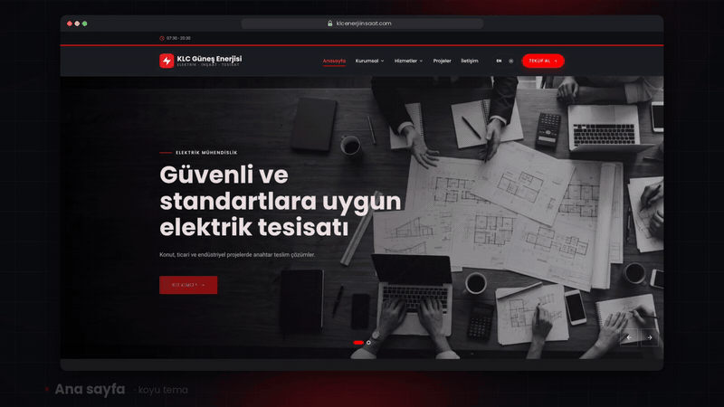

**Tanıtım videosu:** [docs/tanitim-videosu.mp4](docs/tanitim-videosu.mp4) (79 saniye)

## Teknolojiler

| Alan | Seçim |
| :-- | :-- |
| Dil | Java 21 |
| Çatı | Spring Boot 3.5, Spring MVC, Spring Data JPA, Spring Security |
| Arayüz | Thymeleaf (sunucu tarafı), yönetim paneli için ayrı bir tek sayfalık arayüz |
| Veritabanı | PostgreSQL 17, şema sürümleri Flyway ile (20 migration) |
| Kimlik doğrulama | JWT, BCrypt, rol tabanlı yetki (ADMIN / EDITOR) |
| Önbellek | Caffeine |
| Testler | JUnit 5, Mockito, Testcontainers, GreenMail |
| Yayın | Docker Compose, Caddy (otomatik HTTPS), GitHub Actions |

## Özellikler

**Site**
- **Yönetilebilir ana sayfa:** Slider, referans şeridi, hizmet kartları, projeler, kariyer bandı, sayaçlar, çalışma süreci ve teklif bölümü. Bölümlerin sırası, açık/kapalı durumu ve başlıkları panelden değişiyor.
- **Hizmet ve proje sayfaları:** Her hizmetin ve projenin kendi sayfası var. Projeler Türkiye haritasında il il gösteriliyor ve hizmete göre filtreleniyor.
- **Açık ve koyu tema:** Ziyaretçi tek tıkla seçiyor, tercih hatırlanıyor.
- **Türkçe ve İngilizce:** İngilizce sürüm `/en` altında. Arayüz yazıları da veritabanından iki dilde geliyor.
- **Formlar:** İletişim/teklif formu ve CV yüklemeli iş başvuru formu. Gelen kayıtlar panele düşüyor, istenirse e-posta bildirimi gidiyor.
- **Bakım modu:** Panelden tek tuşla açılan, sitenin kimliğini taşıyan bir bakım sayfası.
- **Açılış animasyonu:** Logo çiziliyor, perde kalkıyor. Oturumda bir kez oynuyor; "hareket azaltma" tercihi açıksa hiç oynamıyor.
- **SEO:** Sayfa bazında başlık ve açıklama, canonical, hreflang, yapılandırılmış veri, `sitemap.xml` ve `robots.txt`.

**Yönetim paneli**
- **İçerik yönetimi:** Hizmetler, projeler (galeriyle), sayfalar, ekip, referanslar, sertifikalar, markalar, slider, sayaçlar ve menüler.
- **Zengin metin editörü:** Word benzeri bir editör. Kaydedilmeden önce HTML temizleniyor (jsoup).
- **Medya kütüphanesi:** Yüklenen fotoğraflar küçültülüyor, telefon fotoğrafının yönü düzeltiliyor ve konum dahil meta veriler siliniyor.
- **İstatistikler:** Günlük ziyaretçi, en çok görüntülenen sayfalar, mobil oranı. Çerez kullanmadan, IP saklamadan tutuluyor.
- **Çöp kutusu ve sürümler:** Silinen kayıt geri alınabiliyor, eski sürüme dönülebiliyor.
- **Önizleme ve işlem kaydı:** Değişiklik yayına almadan önizlenebiliyor; panelde kimin neyi değiştirdiği kayıt altında.
- **Yapılacaklar listesi:** Eksik iletişim bilgisi, örnek içerik ya da SEO açıklaması olmayan sayfa gibi eksikleri panelin ana ekranında gösteriyor.
- **Roller:** Firma kendi içeriğini EDITOR hesabıyla yönetiyor; kullanıcılar, yedekler ve SEO gibi bölümler yalnızca ADMIN'e açık.

**Güvenlik ve işletme**
- Yanlış e-posta ve yanlış şifre aynı hatayı veriyor; şifre değişince eski oturumlar hemen geçersiz oluyor.
- Formlarda doğrulama, gizli tuzak alanı ve IP başına oran sınırı var.
- Yüklemelerde uzantı, içerik türü ve dosya imzası birlikte kontrol ediliyor; CV'ler herkese açık adresten verilmiyor.
- Content-Security-Policy ve diğer güvenlik başlıkları, HSTS.
- Gizli değerler ortam değişkeninde; eksik ya da zayıfsa uygulama yayın modunda hiç başlamıyor.
- KVKK saklama süresi dolan form kayıtları her gece siliniyor.
- Her gece veritabanı ve yüklenen dosyalar yedekleniyor, son 14 gün tutuluyor.

## Ekran görüntüleri

| Ana sayfa (koyu) | Ana sayfa (açık) |
| :-: | :-: |
| 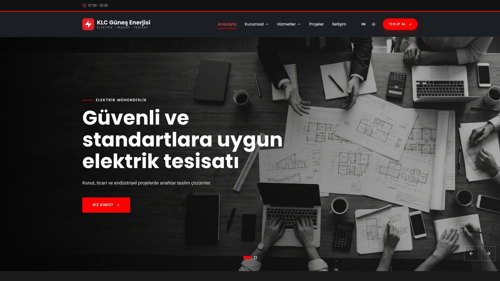 | 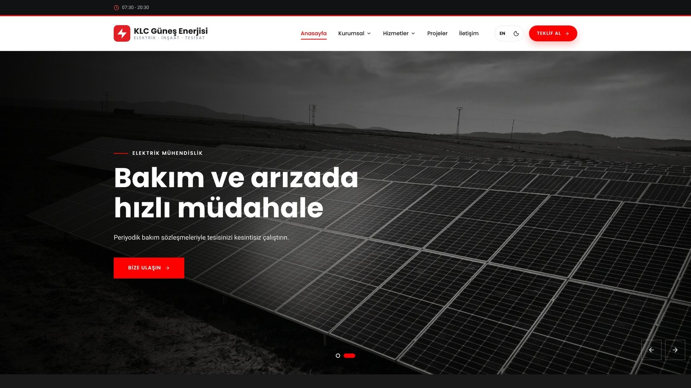 |
| **Hizmetler** | **Projeler haritası** |
| 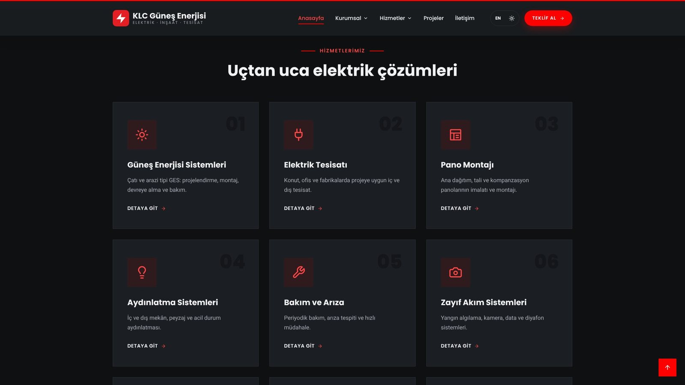 | 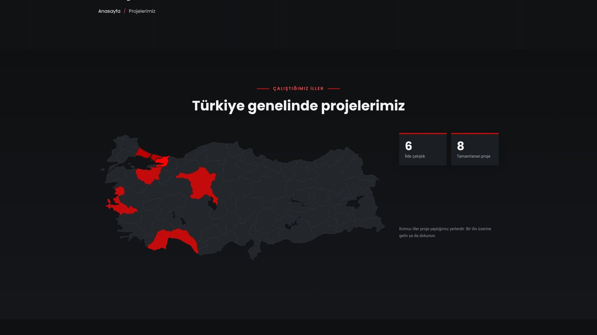 |
| **Açık ve koyu tema** | **Bakım modu** |
| 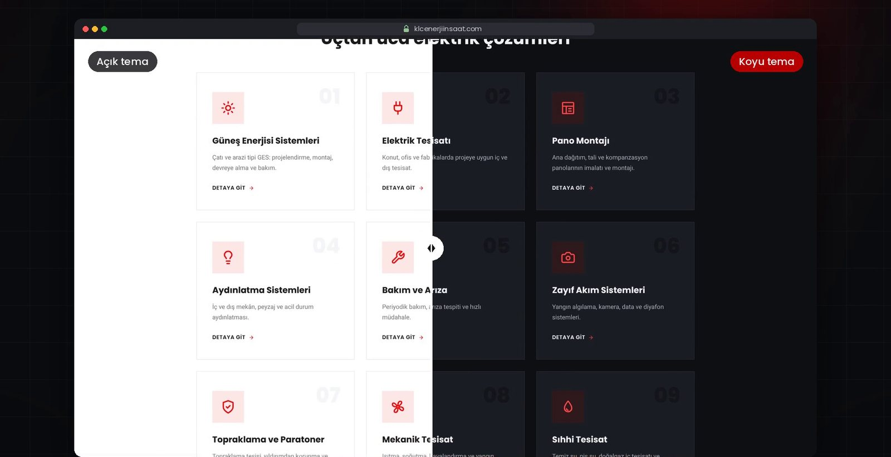 | 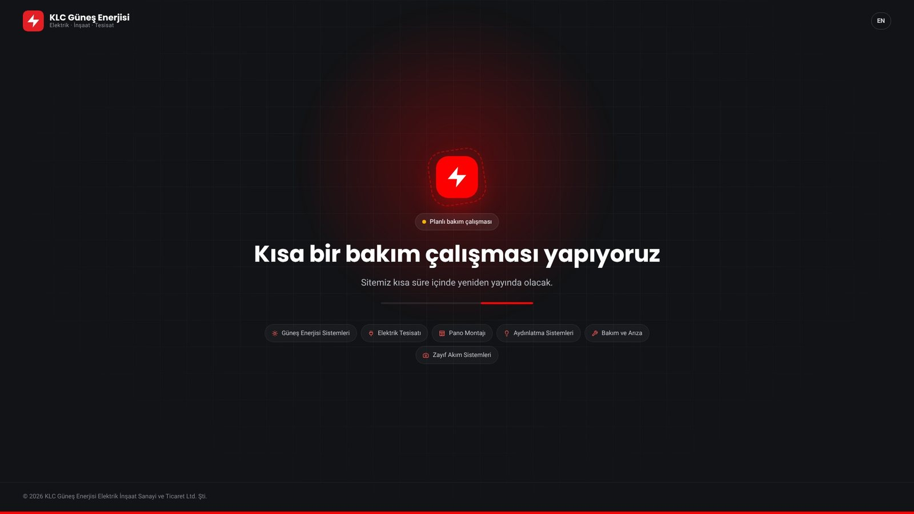 |
| **Telefon** | **Tablet** |
| 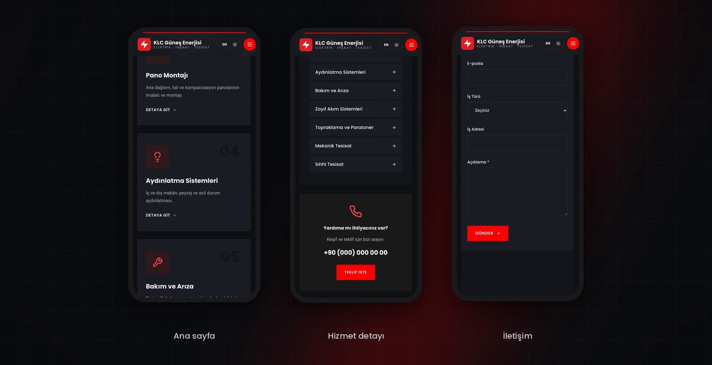 | 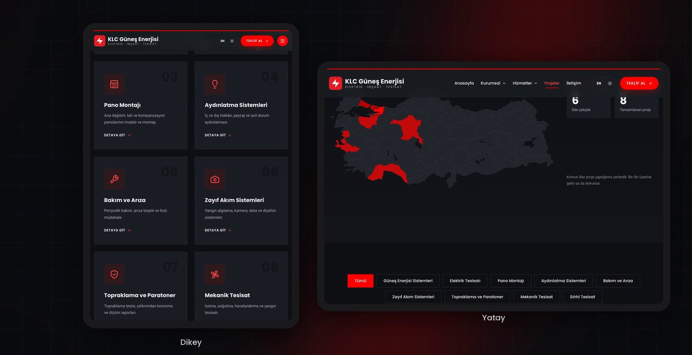 |

**Müşteri paneli**

| İstatistikler | Hizmet listesi | Düzenleme ekranı |
| :-: | :-: | :-: |
| 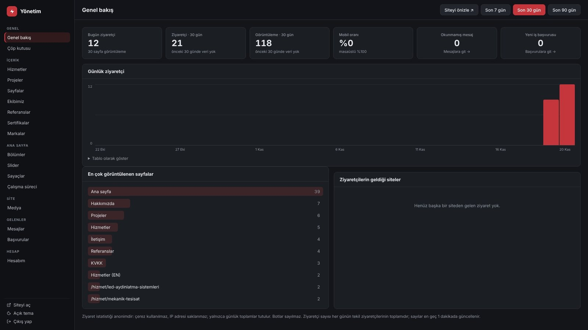 | 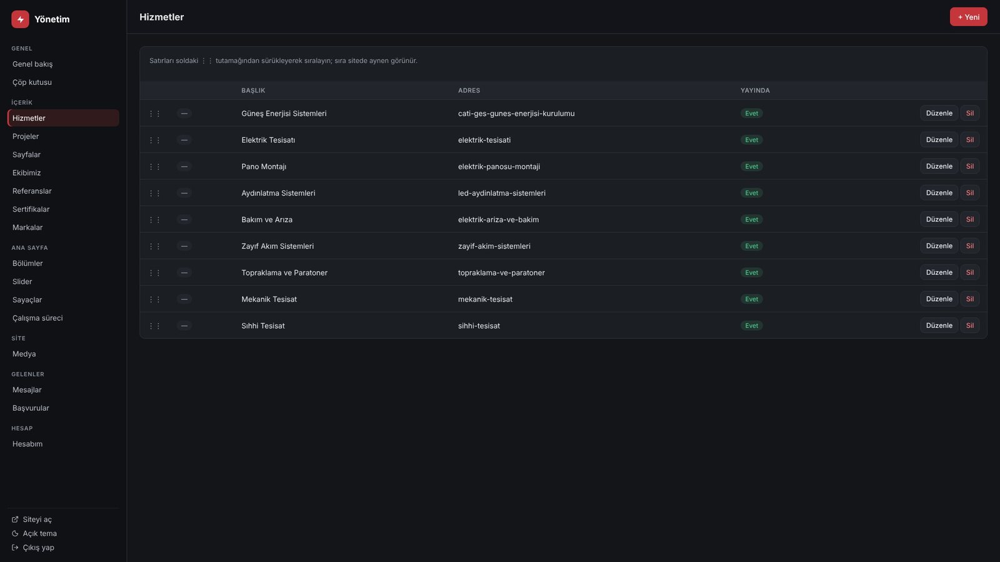 | 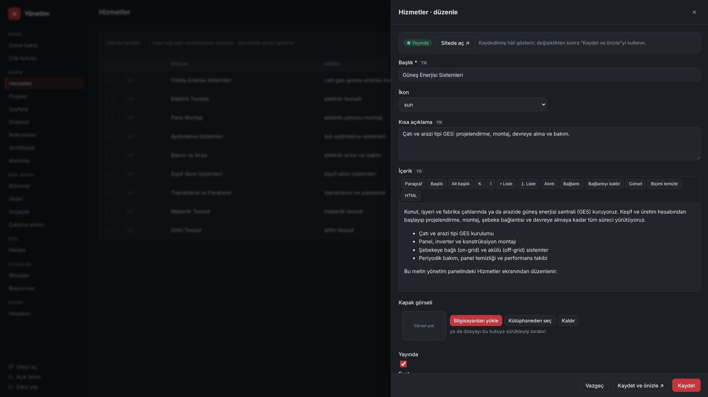 |

## Mimari

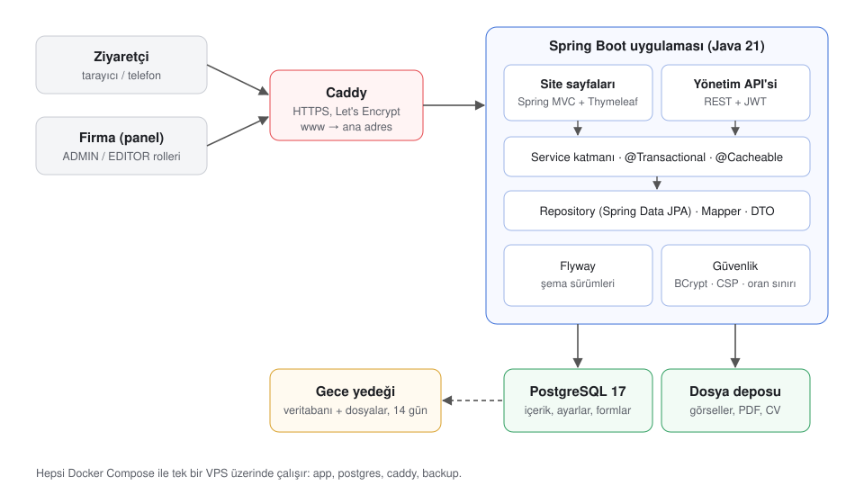

Tek bir Spring Boot uygulaması hem siteyi hem yönetim API'sini sunuyor. Bağımlılık tek yönlü: Controller → Service → Repository.

- **Sayfa controller'ları** Thymeleaf ile HTML üretiyor; modele yalnızca dili çözülmüş Response DTO koyuyor.
- **Yönetim controller'ları** Request DTO alıp `ResponseEntity<ResponseDTO>` dönüyor.
- **Entity'ler servis katmanından çıkmıyor;** dönüşüm her özelliğin kendi Mapper sınıfında.
- **Paketler özelliğe göre ayrılıyor** (hizmet, proje, slider, menü, ayarlar...). Her biri kendi Entity, Repository, Service, Mapper, controller ve DTO'larını içeriyor.
- **Ayarlar veritabanında:** Logo, renkler, yazı tipleri, iletişim bilgileri, bakım modu ve varsayılan SEO bir ayar tablosunda duruyor. Değişince ilgili önbellek temizleniyor ve site anında güncelleniyor.

**Yayın:** Docker Compose dört servis çalıştırıyor: uygulama, PostgreSQL, Caddy ve yedek. Caddy HTTPS sertifikasını kendisi alıp yeniliyor; uygulama dışarıya yalnızca Caddy üzerinden açık. Sunucu 2 GB RAM'li küçük bir VPS olduğu için her servisin bellek sınırı ayrı ayarlandı.

## Neler öğrendim

- **Her şeyi panelden yönetilebilir yapmanın bedeli:** Metinleri koda gömmek kolay ama firma her değişiklik için bana gelmek zorunda kalırdı. Ayarları, menüleri ve arayüz yazılarını veritabanına taşıdım; karşılığında önbellek ve önbellek temizleme kurgusunu düşünmem gerekti.
- **Flyway ile şema sürümleri:** Yayındaki veritabanına elle dokunmadım. Her değişiklik yeni bir migration; eski dosyalar hiç değişmiyor.
- **Gerçek veritabanıyla test:** Uçtan uca testler Testcontainers ile gerçek bir PostgreSQL 17 açıp koşuyor; e-posta bildirimleri de test içinde çalışan bir SMTP sunucusuna (GreenMail) gönderilip okunuyor.
- **İşlem bitince e-posta:** Form kaydı commit edilmeden e-posta gönderilirse, kayıt geri alındığında boşuna bildirim gidiyor. Bunu bir olay yayınlayıp `@TransactionalEventListener(AFTER_COMMIT)` ve `@Async` ile çözdüm.
- **Küçük sunucuda yayın:** 2 GB RAM'de Java, PostgreSQL ve Caddy'yi birlikte çalıştırmak için JVM heap'ini konteyner sınırına göre ayarladım ve PostgreSQL ayarlarını küçülttüm.
- **Güvenlik varsayılanları:** Yayın modunda eksik ya da örnek değerli bir gizli ayarla uygulamanın hiç açılmaması, yanlış yapılandırmayla yayına çıkmaktan daha güvenli.

## Lisans

[MIT](LICENSE) © 2026 Semih Eren

Ekran görüntülerindeki marka, logo ve içerikler ilgili firmaya aittir.
